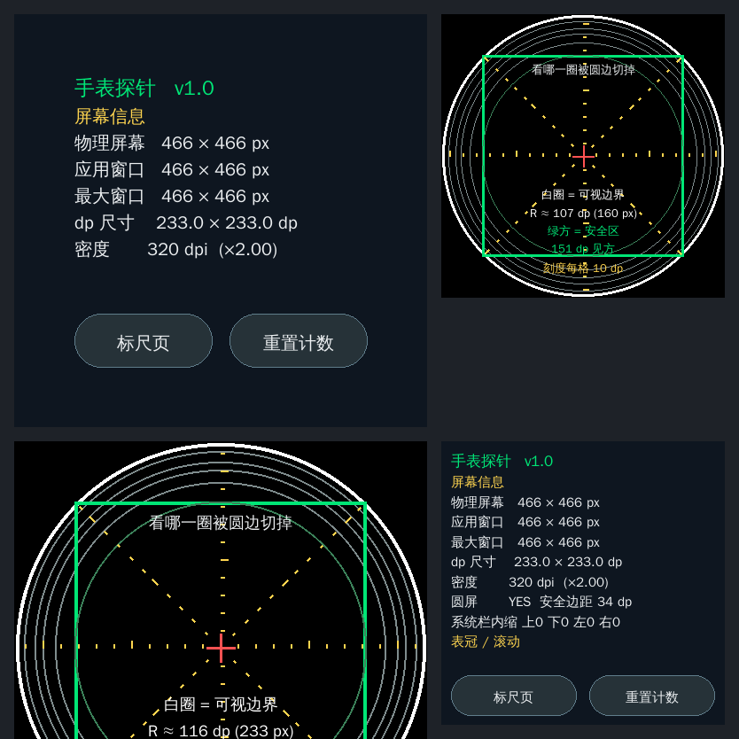

<h1>手表探针 · Watch Spec Scanner</h1>

一款智能手表硬件参数检测与屏幕适配调试工具。

**屏幕规格 · 表冠 / 触控输入事件监测 · 圆屏安全区可视化**

## 它能告诉你什么

| 检测项 | 说明 |
|---|---|
| **屏幕规格** | 物理分辨率、应用窗口、最大窗口、dp 尺寸、密度（dpi 与倍数） |
| **屏型判定** | 是否圆屏、四边 safe inset 内缩值 —— WindowInsets 里真正给到的数字 |
| **圆屏安全区** | 可视化叠加白圈（可视边界）与绿框（安全区），一眼看出哪一圈被圆角切掉 |
| **标尺页** | 带刻度的参考图，用于判断实际可视直径 |
| **表冠旋转** | 通过 `onGenericMotionEvent` 抓取，判断设备表冠是否上报旋转事件 |
| **触控计数** | 单击 / 长按 / 双击 / 拖动分别计数，判断输入通路是否正常 |

## 为什么要这个工具

做手表 App 最痛的两件事：**不知道这块屏到底多大**、**不知道用户的手指到底能不能点到**。

官方文档给的规格和真机往往对不上，圆角裁切不进 WindowInsets，厂家的表冠上报方式各家不同。这个工具就是把这些"猜"变成"读出来"。

## 源码

完整安卓工程在仓库根目录的 `手表探针-源码.zip`，用 Android Studio 直接打开即可编译。

## 许可

个人学习使用，自由使用和修改。
